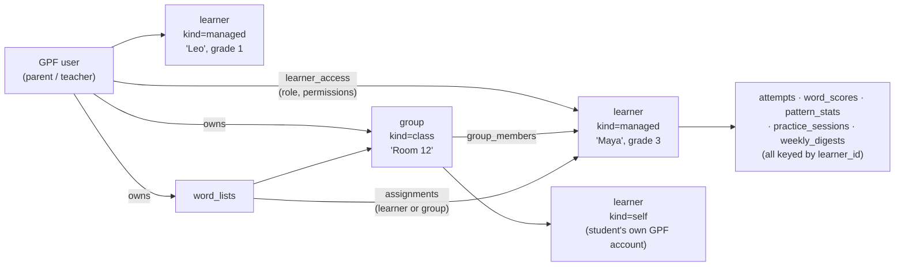

# Family & Classroom Accounts — Plan (F1, F2 built; F3–F6 not started)

## Goal
Let one adult (a **parent** or a **teacher**) set up and follow several children. The adult creates or links learners, assigns word lists, and sees progress and reports for each child, or for a whole class at once. Children practise exactly as they do today; their results belong to their own learner profile, not to the adult.

Parent → child and teacher → student are **the same feature**. Both are a *supervisor* with *learners*. Teachers add groups (classes), bigger limits and class-wide reports.

This builds on the `learner_id` column that Phase 5 already added for this purpose (launch plan, "Family accounts" note). Existing docs are not rewritten; each phase updates its own architecture doc section when built.

> Backend paths below (`apps/spelling-tutor-api/...`, `portfolio-website/...`) live in the `good-plus-fast-website` repo, not this one.

---

## Decisions for you
I made a default for each one so work can start. Change any of them; the ones marked ⚠️ are hard to undo after launch.

| # | Decision | My default | Why it matters |
|---|---|---|---|
| D1 ⚠️ | How do young children sign in? | **No child login.** Children are *managed profiles* inside the adult's account (no email, no password). The child picks their face on the adult's device ("Who's practising?"). | Avoids collecting data from under-13s directly (COPPA). Simplest to build. |
| D2 | Can the child leave their profile without the adult? | **No.** Switching profile or opening adult screens needs a 4-digit **adult PIN** (set once, stored hashed). Can be turned off. | Stops a child opening a sibling's profile or the reports. |
| D3 | Can a learner with their *own* GPF account be linked to an adult? | **Yes, in a later phase (F5)**, via a one-time invite code the learner accepts. Intended for older students and for a second parent. | Needed for teachers whose students already have accounts, and for two-parent families. |
| D4 ⚠️ | Who owns a child's practice data? | **The learner profile.** Every adult linked to it sees the same history. Deleting the profile deletes the history. | Decides what happens when an adult unlinks or deletes their account. |
| D5 | Is "teacher" a different account type? | **No.** Any account can create *groups*. A group can be marked `family` or `class`; the class type unlocks the class report and higher limits. | One code path; no "upgrade to teacher" flow. |
| D6 | Limits | Parent: **8** managed learners. Teacher: **40** learners per class, **5** classes. Lists stay 25 per adult. | AI budget is shared across GPF; limits keep one class from using it all. |
| D7 | Do assigned lists copy or share? | **Shared (by reference).** The adult edits a list once and every assigned learner sees the change. Learners cannot edit assigned lists. | A copy would let lists drift; sharing keeps one source of truth. |
| D8 | What counts as an assignment being "done"? | Every word in the list practised at least once in a session **and** ≥ 80% of words at Harvey-ball level 2 or above. Shown as a percentage, never as a fail. | Drives the "Assigned" badges and the class report. |
| D9 | Weekly digest | One email **per adult**, with a section per learner (not one email per child). Opt-in stays off by default. | Fewer emails; reuses Phase 5c. |
| D10 | Can a learner (or a linked account) see the adult's reports? | **No.** Pattern reports and the digest stay adult-only. Children keep seeing kid tips. | Reports are written to the adult ("your child…"). |
| D11 ⚠️ | Teacher / school privacy | For F6, show a consent note: the teacher confirms they have the school's permission, and we store only a first name or nickname plus grade. No student emails unless they link their own account (D3). Privacy page gets a "Children" section. | Schools may need a data agreement; a lawyer check is wise before marketing to schools. |
| D12 | Existing users | Their account becomes a **self learner** (`learner_id = user_id`). Nothing moves and nothing changes on screen until they add a child. | No data migration risk for current users. |
| D13 | Pricing | **Free during beta**, no paywall code in this plan. | Teacher features are the natural paid tier later; not decided here. |

Answered (2026-10-13):
- **Q1 — Yes.** A teacher invited by a parent sees that child's full history (same view as the parent), through an F5 invite.
- **Q2 — PDF report.** A printable report per learner (F3) and per class (F6), alongside CSV export. See [PDF reports](#pdf-reports).

---

## Core model



* **User** = someone who logs in (unchanged, lives in `good-plus-fast-db`).
* **Learner** = someone who practises. Either `self` (id = their user id) or `managed` (owned by an adult, no login).
* **Access** is always checked as "may *this user* act for *this learner*, and with which permission?".

### New tables (`spelling-tutor-db`, next free migration numbers)

```sql
CREATE TABLE learners (
  id            TEXT PRIMARY KEY,          -- = users.id for kind 'self'
  kind          TEXT NOT NULL,             -- 'self' | 'managed'
  owner_user_id TEXT NOT NULL,             -- the adult who created it (self: the user)
  display_name  TEXT NOT NULL,             -- first name / nickname only
  avatar        TEXT,                      -- emoji or preset key, never a photo
  created_at    DATETIME DEFAULT CURRENT_TIMESTAMP,
  deleted_at    DATETIME                   -- soft delete; hard delete job after 30 days
);
-- grade stays in learner_profiles (already keyed by learner_id)

CREATE TABLE learner_access (
  learner_id   TEXT NOT NULL,
  user_id      TEXT NOT NULL,
  role         TEXT NOT NULL,              -- 'self' | 'owner' | 'guardian' | 'teacher'
  can_assign   INTEGER DEFAULT 1,
  can_view_reports INTEGER DEFAULT 1,
  created_at   DATETIME DEFAULT CURRENT_TIMESTAMP,
  PRIMARY KEY (learner_id, user_id)
);
CREATE INDEX idx_learner_access_user ON learner_access(user_id);

CREATE TABLE learner_groups (
  id            TEXT PRIMARY KEY,
  owner_user_id TEXT NOT NULL,
  name          TEXT NOT NULL,
  kind          TEXT NOT NULL DEFAULT 'family',   -- 'family' | 'class'
  join_code     TEXT UNIQUE,                       -- F6 class code, nullable
  created_at    DATETIME DEFAULT CURRENT_TIMESTAMP,
  archived_at   DATETIME
);
CREATE TABLE group_members (group_id TEXT, learner_id TEXT, added_at DATETIME DEFAULT CURRENT_TIMESTAMP,
  PRIMARY KEY (group_id, learner_id));

CREATE TABLE assignments (
  id          TEXT PRIMARY KEY,
  list_id     TEXT NOT NULL REFERENCES word_lists(id) ON DELETE CASCADE,
  assigned_by TEXT NOT NULL,               -- user id
  learner_id  TEXT,                        -- exactly one of learner_id / group_id
  group_id    TEXT,
  due_at      DATETIME,
  created_at  DATETIME DEFAULT CURRENT_TIMESTAMP,
  archived_at DATETIME
);

CREATE TABLE invites (                      -- F5
  code        TEXT PRIMARY KEY,             -- 8 chars, no look-alike letters
  learner_id  TEXT,                         -- invite an adult to an existing learner, or
  created_by  TEXT NOT NULL,                -- invite a self learner to link to this adult
  role        TEXT NOT NULL,
  expires_at  DATETIME NOT NULL,            -- 7 days
  used_by     TEXT, used_at DATETIME
);

CREATE TABLE supervisor_settings (
  user_id     TEXT PRIMARY KEY,
  pin_hash    TEXT,                         -- D2, PBKDF2 via WebCrypto
  kid_mode_default_learner TEXT,
  updated_at  DATETIME DEFAULT CURRENT_TIMESTAMP
);
```

### Existing tables that must change
Found while reading the code. These are the real work in F1.

| Table / code | Today | Change |
|---|---|---|
| `word_scores` | `UNIQUE(user_id, word)`; every query uses `user_id` | Add `learner_id`, backfill `= user_id`, new unique index `(learner_id, word)`. SQLite cannot drop the old constraint, so **rebuild the table** (create new, copy, rename) in one migration. |
| `attempts` | `learner_id` already written (= user_id) | Write the real learner id. Idempotency index `(user_id, client_id)` stays. |
| `lib/digest.ts` `collectFacts` / weekly job | Reads `attempts.user_id` and `word_scores.user_id`; selects `DISTINCT user_id` | Switch to `learner_id`; job iterates learners, then groups digests by adult (D9). |
| `pattern_stats`, `practice_sessions`, `learner_profiles`, `weekly_digests`, `word_generation_log` | Keyed by `learner_id` but always given `userId` | Only the value passed in changes. |
| `word_lists` | Owned by `user_id` | Unchanged owner. Add nullable `learner_id` for a list made *for* one child (else it is the adult's library). |
| `digest_prefs` | per user | Unchanged (it is the adult's email). |
| `photo_import_log`, AI quotas | per user | Stay per **adult** user — the adult pays the budget for all their learners. |

---

## Request flow
Every learner-scoped call sends the chosen learner:

```
X-Spelling-Learner: <learner_id>     (omitted = the user's self learner)
```

The Astro proxy already forwards all request headers, so no proxy change is needed (`portfolio-website/src/pages/api/spelling/[...path].js`).

New middleware after auth in `apps/spelling-tutor-api/src/index.ts`:
1. Ensure a `learners` + `learner_access` row exists for the user's self learner (cheap upsert, same spot as the shadow-user upsert).
2. Read the header; if present, look up `learner_access (learner_id, user_id)` and `learners.deleted_at IS NULL`. Missing → **404** (same as a list that does not exist, matching the current URL-is-not-a-credential rule).
3. `c.set('learnerId', …)` and `c.set('access', { role, canAssign, canViewReports })`.
4. Routes swap `c.get('userId')` → `c.get('learnerId')` wherever the data is the child's (attempts, scores, patterns, profile, digest, generate words). Report routes (`/patterns/:p/analyze`, `/digest/*`) also require `canViewReports`.

One `requireLearnerAccess` helper owns this check; a test asserts every learner route goes through it (route table scan), so a new route can't skip it.

## Front end (this repo)
* `useLearner.jsx` context: `{ learners, activeLearner, setActiveLearner, isKidMode }`. Persisted in `localStorage` (`spelling_tutor_active_learner_v1`). `apiService.js` adds the header.
* `attemptQueue.js`: each queued attempt stores `learner_id`; the flush groups by learner and sends one request per learner. Old queued items without it belong to the self learner.
* Lists cache (`spelling_tutor_lists_v5`) stays the adult's library. Assigned lists come from a new read-only endpoint and are cached per learner.
* Kid mode hides: Profile, Progress reports, list editing, photo import, settings. Exiting needs the PIN (D2).
* New URLs (relative to `/spelling/app`):

| URL | Screen |
|---|---|
| `/who` | "Who's practising?" picker (avatars + "Grown-up" tile) |
| `/family` | Adult's learners and groups: add, rename, grade, avatar, delete |
| `/family/:learnerId` | One learner: summary, assignments, progress (reuses ProgressPage) |
| `/class/:groupId` | Class report (F6) |
| `/join/:code` | Accept an invite (F5) |

Progress, word detail and pattern screens are reused as-is with the learner switched; no duplicate pages.

---

## Phases
Each phase ships on its own and is safe to deploy with the next one unbuilt.

### F1 — Learner foundation (no visible change) — ✅ built (2026-10-14)
> Built in `good-plus-fast-website` on branch `ccr-e562d473-9a1h7s`: migration `0012_learners.sql` (0011 left free for `handled_at`), `src/lib/learners.ts`, middleware + routes in `src/index.ts`, tests in `src/learners.test.ts`. Not yet deployed — see *Deploying F1* below. Only `learners` and `learner_access` were created; the group, assignment, invite and settings tables are created by the phase that first uses them.
Backend only. Learners and access tables; self-learner upsert; `X-Spelling-Learner` middleware; `word_scores` rebuild; every route moved to `learnerId`; digest reads `learner_id`.
**Done when:** all existing tests pass with no header sent; new tests prove a user gets 404 for a learner they are not linked to, on every learner route; production data unchanged except new rows.

**Deploying F1** (order matters — the new code needs the new tables):
1. Back up: `npx wrangler d1 export spelling-tutor-db --remote --output backup-before-0012.sql`
2. Migrate: `npx wrangler d1 migrations apply spelling-tutor-db --remote`
3. Check: `SELECT COUNT(*) FROM learners` equals `SELECT COUNT(*) FROM users`; `SELECT COUNT(*) FROM word_scores` unchanged.
4. Deploy the Worker: `npm run deploy` in `apps/spelling-tutor-api`.

### F2 — Parent: child profiles + kid mode — ✅ built (2026-10-14)
> Backend (`good-plus-fast-website`): migration `0013_family_pin.sql`, `lib/family.ts`, `lib/pin.ts`, `/api/spelling/family/*`, 30-day purge in the cron; tests in `src/family.test.ts`. Front end (this repo): `activeLearner.js`, `familyApi.js`, `useLearner.jsx`, `WhoPage`, `FamilyPage`, `PinPad`, header/route guards, per-learner storage keys; tests in `familyMode.test.jsx` and `attemptQueue.learner.test.js`. Deploy: apply migration `0013` (`wrangler d1 migrations apply spelling-tutor-db --remote`) **before** the Worker, then publish the app.
> Found while building: deck progress and hiding state live in the browser keyed by list only, so two children on one device would have shared them. They are now scoped per learner (the user's own keys are unchanged).
Create / edit / delete managed learners (D1, D6). "Who's practising?" picker, adult PIN (D2), header wiring, per-learner attempt queue. Grade per child (existing `learner_profiles`).
**Done when:** a parent with two children can hand the phone to each child, each child's practice lands only in their own progress, and the child cannot reach adult screens without the PIN.

### F3 — Monitoring & reports for the adult
* `/family` overview: one card per learner — last practised, minutes / sessions this week, words mastered, struggling count, active patterns (all from existing tables).
* `/family/:learnerId`: existing Progress page for that child plus pattern reports.
* `GET /api/spelling/supervisor/overview` returns all linked learners' summary in one call (no N+1 from the client).
* Weekly digest per adult with a section per child (D9).
* **PDF report per learner** (Q2) — see [PDF reports](#pdf-reports).
**Done when:** a parent can answer "how is each child doing this week?" from one screen and one email.

### F4 — Assignments
Assign a list to a learner or a group, optional due date (D7). Children see an **Assigned** row at the top of their lists with a progress ring; the adult sees completion per learner (D8). Assigned lists are read-only for the child.
Endpoints: `POST/GET/DELETE /api/spelling/assignments`, `GET /api/spelling/assigned-lists` (learner view).
**Done when:** a parent assigns "Week 6" to two children and sees each one's completion update after practice.

### F5 — Linking existing accounts (invites)
Invite codes (D3, Q1) for: a second parent joining a child; an adult linking a student who has their own account; a parent granting a teacher view access. Accept at `/join/:code`. Either side can unlink; unlinking never deletes data (D4).
**Done when:** two adults see the same child, and a student with their own login shows up in an adult's list after accepting.

### F6 — Teacher / classroom
Groups of kind `class` (D5), roster bulk add (paste one name per line), class code for adding self learners, class report: a table of students × (sessions this week, assignment completion, top struggling words, active patterns) sortable and filterable, plus "class-wide patterns" (patterns active for ≥ 3 students). CSV export. **Class PDF report** plus one-click "all students" PDF (Q2). Consent note (D11).
**Done when:** a teacher with 25 students sees who has not practised, who is stuck, and which pattern to teach next, on one screen.

---

<a id="pdf-reports"></a>
## PDF reports (Q2)
For parent–teacher meetings. Built as a **print-ready page** that the browser saves as PDF (Print → Save as PDF; a "Download PDF" button calls `window.print()`). No PDF library on the Worker, no stored files, and it works offline from cached data.

* **Learner report** — `/family/:learnerId/report?from=&to=` (default: last 4 weeks). One to two A4/Letter pages:
  1. Header: learner nickname, grade, date range, generated date (no emails or account ids).
  2. Summary tiles: sessions, minutes practised, words practised, words mastered, accuracy, trend vs previous period.
  3. Assignments: list name, due date, completion % (D8).
  4. Spelling patterns: active and cleared, with the cached AI pattern report summary and practice ideas.
  5. Hardest words (top 10 by friction) and recently mastered words.
  6. Simple weekly bar chart of sessions (inline SVG, prints in black and white).
  7. Space for adult notes (blank lines).
* **Class report** (F6) — `/class/:groupId/report`: page 1 is the class table and class-wide patterns; "All students" option appends one learner report per student with page breaks.
* Data: one call, `GET /api/spelling/supervisor/report?learner=&from=&to=`, requires `canViewReports`. Same access checks as every other learner route.
* Styling: `@media print` stylesheet (no header, nav or keyboard; fixed page size; `break-inside: avoid` on sections). Tested with a Playwright print-to-PDF snapshot.
* Not in scope: emailing the PDF, server-side generation. Revisit only if browsers' Save as PDF proves unreliable on phones.

---

## Security & privacy checklist
* Every learner route goes through `requireLearnerAccess`; tested by a route-table scan test.
* IDs in URLs are not credentials; unknown or unlinked = 404.
* Managed learners store nickname, avatar key and grade only. No photos, no emails, no birthdays.
* PIN: hashed (PBKDF2, per-user salt), 5 wrong tries → 5-minute lockout.
* Invite codes: single use, 7-day expiry, rate-limited (10 per adult per day).
* Delete learner: soft delete, hidden at once, hard-delete job after 30 days removes attempts, scores, patterns, digests, sessions.
* Delete adult account: managed learners they *own* are deleted; learners they are only linked to are unlinked.
* AI quotas stay per adult, so adding children does not multiply the budget.
* Privacy page: add "Children" section for the spelling app before F2 ships (D11).

## Testing
* API (`api.test.ts`): access matrix — self / owner / guardian / teacher / stranger × every learner route; `word_scores` migration on a copy of real-shaped data; digest grouping.
* Client: `useLearner` switching, attempt queue grouping by learner, kid-mode route guard, PIN flow, assigned-list badges.
* Manual: two-child phone hand-off; offline practice as child A, switch to child B, reconnect — each child's attempts land correctly.

## Rough size
| Phase | Size |
|---|---|
| F1 | M — mostly careful refactor + one table rebuild |
| F2 | M |
| F3 | M (data already exists; PDF report adds S) |
| F4 | M |
| F5 | S |
| F6 | M–L (class PDF adds S) |
