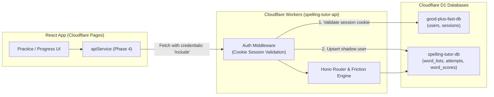

# Backend API & D1 Database Architecture

This document describes the backend design, authentication handshake, and database schema for the Spelling Tutor app.

---

## Architecture & Data Flow

---

## Database Schema (`spelling-tutor-db`)

### `users` (Shadow User Table)
*Mirrors authenticated accounts from `good-plus-fast-db` to allow local relational integrity without cross-database joins.*
- `id` (TEXT, PK): Matches `users.id` in `good-plus-fast-db`
- `email` (TEXT)
- `created_at` (DATETIME)

### `word_lists`
*Stores user-created or imported custom spelling lists.*
- `id` (TEXT, PK): UUID
- `user_id` (TEXT, FK -> `users.id` ON DELETE CASCADE)
- `name` (TEXT): Name of the spelling list (e.g. "Week 4 — Prefixes")
- `words_raw` (TEXT): Hyphenated syllable text lines (e.g. `con-trol\npro-ject`)
- `is_default` (INTEGER): `1` if this is currently the active list, `0` otherwise
- `focus_groups` (TEXT, nullable): JSON array of the lesson's letter groups, e.g. `["ou","ow"]`; turns on smart hiding (migration `0006`). `NULL` on update = keep the stored value
- `hints` (TEXT, nullable): JSON array (max 5) of short lesson hints shown as plain text after a miss (migration `0006`)
- `created_at` (DATETIME)
- `updated_at` (DATETIME)

### `attempts`
*Granular per-letter practice history for every practice exercise.*
- `id` (TEXT, PK): UUID
- `user_id` (TEXT, FK -> `users.id` ON DELETE CASCADE)
- `word` (TEXT): The full target word
- `letter` (TEXT): The letter tested
- `position` (INTEGER): Zero-indexed position of letter in word
- `correct` (INTEGER): `1` if correct, `0` if mistake
- `practiced_at` (DATETIME)
- `client_id` (TEXT, nullable): client-generated id; partial unique index `(user_id, client_id)` makes retried batches idempotent (migration `0002`)
- `session_id` (TEXT, nullable): one visit to a list; scoring counts the last answer per letter per session (migration `0003`)
- `typed` (TEXT, nullable): the letter the child actually entered (for reversals) (migration `0003`)
- `learner_id` (TEXT): who practised (migration `0003`). Equals `user_id` for a self learner; a child profile's id when an adult records for them. `user_id` is always the logged-in account that recorded it

### `word_scores`
*Aggregated struggle metrics per word per learner, updated automatically on batch practice submission. Rebuilt in migration `0012` to key on the learner.*
- `id` (TEXT, PK): UUID
- `user_id` (TEXT, FK -> `users.id` ON DELETE CASCADE): the account that recorded it
- `learner_id` (TEXT): who the score belongs to (migration `0012`)
- `word` (TEXT)
- `attempt_count` (INTEGER)
- `error_count` (INTEGER)
- `friction_score` (INTEGER): Exponential consecutive error penalty score
- `ai_suggestion` (TEXT, nullable): Cached JSON memory trick generated by Cloudflare Workers AI
- `perfect_streak` (INTEGER): consecutive perfect sessions (migration `0003`)
- `mastered_at` (DATETIME, nullable): attempts before this no longer count toward friction (migration `0003`)
- `last_practiced` (DATETIME)
- Constraint: `UNIQUE(learner_id, word)` (was `(user_id, word)` before `0012`)

### `practice_sessions` / `pattern_stats` (migration `0003`)
See [`05_ai_engine.md`](./05_ai_engine.md). `practice_sessions(id, learner_id, list_id, started_at, last_seen_at)`; `pattern_stats(learner_id, pattern, attempts, misses, distinct_words, sessions_missed, missed_words_json, status, first_qualified_at, cleared_at, report_json, report_generated_at, updated_at)` keyed by `(learner_id, pattern)`.

### Smart hiding tables (migrations `0007`-`0010`)
- `syllable_cache(word PK, split, created_at)` (`0007`): one row per word the AI split, shared by all users; `split = ''` means the answer failed validation.
- `photo_import_log(id, user_id, ip_hash, created_at)` (`0008`): per-user daily and per-IP hourly photo limits. The IP is stored hashed; the photo is never stored.
- `learner_profiles(learner_id PK, grade, updated_at)` (`0009`): student grade 0 (K) to 8, default 3. `pattern_stats` gains `last_practiced_at`. `word_generation_log(id, learner_id, pattern, accepted_json, rejected_json, created_at)`: daily cap and a record of rejected words.
- `pattern_candidates(pattern, source, example_words_json, count, first_seen, last_seen, handled_at)` (`0010`, `handled_at` added in `0011`): letter groups the tagger doesn't recognise (`source` = `untagged` | `photo`). Aggregates only, no learner ids. Shown on the admin portal's Spelling patterns page; `handled_at` hides a group until it is seen again.

### `learners` / `learner_access` (migration `0012`, family accounts F1)
See [`../action_plans/family_and_classroom_plan.md`](../action_plans/family_and_classroom_plan.md). A *user* logs in; a *learner* practises.
- `learners(id PK, kind 'self'|'managed', owner_user_id, display_name, avatar, created_at, deleted_at)`: every user is their own `self` learner (`id = users.id`), created by the auth middleware on each request (`INSERT OR IGNORE`). `managed` child profiles arrive in F2. `deleted_at` hides a learner at once.
- `learner_access(learner_id, user_id, role 'self'|'owner'|'guardian'|'teacher', can_assign, can_view_reports, created_at)`, primary key `(learner_id, user_id)`: which users may act for which learner.
- Requests pick a learner with the **`X-Spelling-Learner`** header (none = the user's self learner). The auth middleware resolves it (`lib/learners.ts` → `resolveLearner`); no access, a deleted learner or a malformed id returns **404** on every route, the same as a learner that does not exist. Practice data routes (attempts, scores, patterns, profile, digest/latest) use the learner; lists, digest prefs, syllables, photo import and AI quotas stay with the logged-in user. `can_view_reports = 0` → 403 on `/patterns/:p/analyze` and `/digest/latest`.

### Family accounts tables (migrations `0013`-`0016`)
- `supervisor_settings(user_id PK, pin_hash, pin_salt, pin_failed, pin_locked_until, updated_at)` (`0013`): the adult PIN for kid mode. PBKDF2-SHA256 (100,000 iterations, per-user salt); 5 wrong tries lock it for 5 minutes. A soft lock against a child, not account security.
- `assignments(id, list_id -> word_lists ON DELETE CASCADE, learner_id, assigned_by, due_at, created_at, archived_at, group_id)` (`0014`, `group_id` from `0016`): one row per learner (a class assignment is one row per student); unique `(list_id, learner_id)` while not archived. Progress is computed, not stored (see `lib/assignments.ts`).
- `invites(code PK, kind 'share_child'|'link_me', created_by, learner_id, role, can_assign, can_view_reports, expires_at, used_by, used_at, created_at)` and `invite_attempts(user_id, ok, at)` (`0015`): single-use 7-day codes; the attempts table rate-limits guessing (10 wrong codes an hour).
- `learner_groups(id, owner_user_id, name, join_code UNIQUE, consent_at, created_at, archived_at)` and `group_members(group_id, learner_id, added_at)` (`0016`): a teacher's classes. `join_code` NULL = closed; while open it is reusable (not an invite) and `lookupInvite` falls back to it.
- `deck_progress(learner_id, list_id -> word_lists ON DELETE CASCADE, word, level 1..5, mastered, updated_at)` (`0017`): each word's deck stage for a list assigned to the learner, reported by the app. The latest report wins, so it can go down. An assignment is complete when every word is mastered; `percent` = stages passed over all words and stages.
- Names: a child is a first name plus an optional last initial (`nicknameProblem` in `lib/family.ts`); no full last names, emails, links or phone numbers.
- Limits: 8 child profiles per adult (200 once they have a class); 5 classes per teacher; 40 students per class. Deleting a child or class student hides them at once and the cron purges all their data after 30 days (`purgeDeletedLearners`).

### `weekly_digests` / `digest_prefs` (migration `0004`)
`weekly_digests(learner_id, week_start, digest_json, created_at)`, primary key `(learner_id, week_start)`: one digest per learner per 7-day period (built for children too; the learner's owner pays for the AI summary). The weekly job sends **one link-only email per opted-in adult** who can view any of them (including a teacher whose class practised): a link to the dashboard (`/spelling/app/family`, plus `/classes` for a teacher) and the unsubscribe link, with no names and no numbers. The details are in the app, where reports export as PDF or HTML. `digest_prefs(user_id, email_opt_in, unsubscribe_token, updated_at)`: the weekly-email opt-in (default off) and the token used by the unsubscribe link.

---

## API Endpoints (`spelling-tutor-api`)

| Method | Path | Auth Required | Description |
|---|---|---|---|
| `GET` | `/api/spelling/health` | No | Worker health status and phase |
| `GET` | `/api/spelling/lists` | Yes | Get all saved word lists for authenticated user |
| `GET` | `/api/spelling/lists/:id` | Yes | One list (owner only; anyone else gets 404) |
| `POST` | `/api/spelling/lists` | Yes | Create a list (optional client UUID `id`) |
| `PUT` | `/api/spelling/lists/:id` | Yes | Upsert with a client-generated UUID; 409 at 25 lists |
| `DELETE` | `/api/spelling/lists/:id` | Yes | Delete a custom word list by ID |
| `POST` | `/api/spelling/attempts` | Yes | Submit up to 500 attempts (`client_id` for idempotency); returns `{ recorded, duplicates, words_updated }` |
| `GET` | `/api/spelling/scores` | Yes | List all word struggle scores |
| `GET` | `/api/spelling/scores/hardest` | Yes | Top N hardest words (`friction_score > 0`) |
| `GET` | `/api/spelling/patterns` | Yes | Learner's spelling patterns with label, status, accuracy, last practiced, examples and cached report |
| `POST` | `/api/spelling/patterns/positions` | Yes | `{ words }` -> letter positions covered by the learner's active patterns (smart hiding level-3 override) |
| `POST` | `/api/spelling/patterns/:pattern/generate` | Yes | 5 grade-appropriate words with the pattern; 20 successful requests/learner/day |
| `POST` | `/api/spelling/syllables` | Yes | `{ words }` -> `{ splits }` for words the app's dictionary doesn't know (cached) |
| `POST` | `/api/spelling/import/photo` | Yes | Raw JPEG/PNG/WebP body (max 4 MB) -> `{ title, words, focus_groups, hints }`; 5/day per user, 10/hour per IP |
| `GET` / `PUT` | `/api/spelling/profile` | Yes | `{ grade }` (0-8) |
| `GET` | `/api/spelling/admin/pattern-candidates` | Admin | New-pattern candidates (30 days, top 100), the list the admin portal shows |
| `POST` | `/api/spelling/scores/:word/analyze` | Yes | Kid tip for a tricky word (Phase 5b) |
| `POST` | `/api/spelling/patterns/:pattern/analyze` | Yes | Parent report for an active pattern (Phase 5b) |
| `GET` | `/api/spelling/scores/:word` | Yes | One word: score, per-letter results, tip (Phase 5c) |
| `GET` / `POST` / `PUT` / `DELETE` | `/api/spelling/family`, `/family/learners[/:id]`, `/family/pin[/verify]` | Yes (user-level) | Learner list, child profiles (max 8, owner-only edit/delete, 30-day purge), the grown-up PIN (family accounts F2) |
| `POST` / `GET` / `DELETE` | `/api/spelling/family/invites[/:code]`, `GET /family/invites/:code/preview`, `POST /family/invites/:code/accept` | Yes (user-level) | Invite codes: `share_child` and `link_me`; a class code also works at preview/accept (F5, F6) |
| `GET` / `DELETE` | `/api/spelling/family/learners/:id/access[/:userId]` | Yes (user-level) | Who can see a learner you own; remove someone, or leave (never deletes data) (F5) |
| `GET` / `POST` / `PUT` / `DELETE` | `/api/spelling/groups[/:id[/students\|members\|code\|overview\|assign]]` | Yes (user-level) | A teacher's classes: roster, class code, overview, whole-class assignment (F6) |
| `POST` / `GET` / `DELETE` | `/api/spelling/assignments[/:id]` | Yes (user-level) | Assign a list to learners, read a learner's assignments with progress, archive one (F4) |
| `GET` | `/api/spelling/assigned-lists` | Yes (learner) | Lists assigned to the current learner, with the words (F4) |
| `PUT` / `GET` | `/api/spelling/progress/:listId` | Yes (learner) | Report / read each word's deck stage for an assigned list; the latest report wins (F4) |
| `GET` | `/api/spelling/supervisor/overview` | Yes (user-level) | A summary per child the adult follows (F3) |
| `GET` | `/api/spelling/supervisor/report?learner=&from=&to=` | Yes (user-level) | Period report for one learner; needs `can_view_reports` (F3) |
| `GET` | `/api/spelling/digest/latest` | Yes | Newest weekly digest (Phase 5c) |
| `GET` / `PUT` | `/api/spelling/digest/prefs` | Yes | Weekly email opt-in (Phase 5c) |
| `GET` | `/api/spelling/digest/unsubscribe` | No (token) | Unsubscribe link from the email (Phase 5c) |
