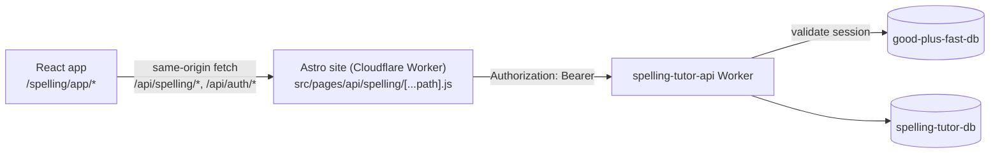

# Auth, URLs & Data Sync (Phase 4)

How the app knows who the user is, how word lists and practice history reach the cloud, and how every screen and list gets its own URL.

---

## 1. Request path (why there is a proxy)

The `session` cookie is `HttpOnly`, `SameSite=Lax` and belongs to `goodplusfast.com`; the API Worker lives on `*.workers.dev`, so browsers never send the cookie to it. Same pattern as Flashy Cards:

* The Astro route reads the cookie and forwards it as a Bearer token; the Worker prefix `/api/spelling` is kept. It copies every other request header too, so `X-Spelling-Learner` (family accounts) reaches the Worker without a proxy change.
* `apiService.js` uses relative URLs. Set `VITE_API_ORIGIN` for builds served from another origin (Capacitor, Phase 7).
* Dev: `vite.config.js` proxies `/api` to the local Astro site (`localhost:4321`).

**Running the Astro site locally:** use a plain `npm run dev` in `jerome-portfolio`. Its `astro.config.mjs` defaults to the `@astrojs/cloudflare` adapter with `platformProxy` enabled, which is what wires up `locals.runtime.env.good_plus_fast_db` against the local D1 sqlite file in `.wrangler/state/v3/d1/`. Do **not** set `ADAPTER=node` for this — that swaps in `@astrojs/node`, which has no Cloudflare bindings at all, and every `/api/auth/*` route will 500 with "Database binding not found" (there's no D1, no `locals.runtime`, nothing — `import.meta.env` doesn't have it either). If you ever see that error locally, check for a stale `ADAPTER` env var in the shell or a leftover dev server still bound to port 4321 from an earlier run. `tools/07.launch_dev_real.bat` runs this correctly (`tools/01.launch_dev.bat` now uses the mock API instead and is always logged in).

**`/admin/ai-credits` will 500 locally** (`fetch failed` / `ECONNREFUSED` on `/api/fc/admin/ai-status`) because it also calls the Flashy Cards worker, which `01.launch_dev.bat` does not start — getting that worker's `good_plus_fast_db` binding to see the same local users/sessions/AI-quota data as the Astro site (they default to separate local D1 files per project) turned out more trouble than it was worth for a page only the admin account uses. Test `/admin/ai-credits` on production instead.

## 2. Auth state (`useAuth.jsx`)

`status`: `loading` → `anonymous | authenticated | expired`. Checked via `GET /api/auth/me` on load, on window focus and on tab visibility (so logging in or out in another tab is picked up). `authenticated → not authenticated` becomes `expired` (UI says "Log in again"; local data is untouched). Offline or server errors never log the user out.

Login links go to `/login?redirect=<current path+query+hash>`. The main site validates the target with `safeRedirect()` (same-site paths only) for password login, Google OAuth (`login_redirect` cookie) and the login/signup toggle, so users return to the exact URL they left. Email-verification links for new accounts do not carry the redirect.

## 3. URL scheme (relative to `/spelling/app`)

| URL | Screen |
|---|---|
| `/` | Redirects to the last-used list |
| `/lists` | All lists |
| `/lists/default` | Built-in default list (virtual, never synced until edited) |
| `/lists/:listId` | Practice one list — `listId` is a client-generated UUID that is also the server primary key |
| `/progress` | Progress dashboard (`?list=<id>` filters). A child in kid mode sees their own, without the weekly summary, email setting or pattern reports |
| `/progress/words/:word` | One word: letter-by-letter results and its tip (Phase 5c) |
| `/who` | "Who's practicing?": children plus a Grown-up tile; choosing a child starts kid mode (family accounts F2) |
| `/family` | Add / edit / delete children, this week's summary, assign lists, share a child, codes, grown-up PIN (not in kid mode) |
| `/family/:learnerId/report` | Printable report: Download PDF / Download HTML (not in kid mode) |
| `/join`, `/join/:code` | Enter an invite or class code, see what it does, accept (not in kid mode) |
| `/classes`, `/classes/:groupId` | A teacher's classes: roster table, who needs a look, class code, assign to class, exports (not in kid mode) |

* URLs are addresses, not credentials. The API scopes every query by `user_id`; another user's id returns 404, identical to a non-existent list. Lists that exist only in one anonymous browser resolve only there.
* Deep links need SPA fallback: `public/_redirects` (`/* /index.html 200`). The proxy Worker forwards any `/spelling/app*` path and strips the prefix.
* `main.jsx` mounts `BrowserRouter` with `basename` from `import.meta.env.BASE_URL`.

## 4. Local-first list sync

The UI reads and writes `localStorage` (`spelling_tutor_lists_v5`); sync runs in the background (`useLists.jsx` → `syncService.js`).

List: `{ id, name, wordsRaw, isDefault, updatedAt, dirty, deleted, focusGroups, hints }` (the last two are smart hiding; synced as `focus_groups` / `hints`). Editing the virtual default creates a real list.

`mergeLists(local, remote)` (pure, tested):

| Situation | Result |
|---|---|
| Remote only | Add locally |
| Local tombstone (`deleted`) | `DELETE` remotely |
| Both, local `dirty` and newer | `PUT /lists/:id` (upsert) |
| Both, otherwise | Remote wins |
| Local only, dirty (created offline / before first login) | `PUT` |
| Local only, clean | Deleted on another device — drop locally |

`reconcile()` folds the result into the *current* state so edits made while requests were in flight are never lost. Conflict policy is **last-write-wins per list**; the server `updated_at` is authoritative after a push.

Triggers: becoming authenticated, 1.5 s after a local edit, every 30 s while anything is pending, `online`, manual refresh. Failures set `syncStatus` (`offline | error | partial`); a 401 flips auth to `expired`. Limits: 25 lists per user, 20 KB per list (server enforces; UI shows a message).

Legacy storage (`spelling_tutor_words_v4/v3/v2`) migrates once into a dirty list named "My Words" (unless it is a copy of the default).

## 5. Practice attempts (`attemptQueue.js`)

* `WordCard.handleVerify` reports one attempt per checked hidden letter: `{ letter, position (global index), correct }` for `word.word` (never the phonetic override text). Retrying after a miss records again — that is the "consecutive misses" signal the friction score uses.
* Attempts are always queued locally (`spelling_tutor_attempt_queue_v1`, cap 1000 — oldest dropped) and each gets a `client_id`.
* When authenticated the queue is flushed to `POST /api/spelling/attempts` in chunks of 400 (server max 500). A retried batch is harmless: the API does `INSERT OR IGNORE` against the partial unique index `(user_id, client_id)` (migration `0002`), so scores are never double-counted.
* Chunk acknowledged → removed. Offline/401 → kept. 400 → dropped (a bad row must not block the queue). On page hide the queue is flushed with `keepalive`.
* Anonymous attempts stay queued and upload on first login.

## 6. Progress page

Flushes the queue, then loads scores, patterns and the latest weekly digest in parallel (patterns and the digest are extras: if either fails the word progress still shows; in kid mode only the scores are requested). Shows the weekly summary and email opt-in, stat tiles, the Mastered / Struggling / Needs-practice buckets, the spelling patterns list with parent reports, and a table of all words sorted by friction score. Empty, loading, offline, expired and error states are handled. Flames on the practice page open an AI tip (see `05_ai_engine.md`).

## 6b. Family accounts (F2 to F6)

See [`../action_plans/family_and_classroom_plan.md`](../action_plans/family_and_classroom_plan.md).

* **Active learner** (`services/activeLearner.js`, `hooks/useLearner.jsx`): `{ id: null }` = the user themselves (nothing changes for existing users); `{ id, kid }` = a child, in kid mode when `kid`. Stored in `spelling_tutor_active_learner_v1`. `apiFetch` adds `X-Spelling-Learner` to `/api/spelling/*` calls (not `/api/spelling/family/*`, which are user-level). The routes are wrapped in `<Routes key={activeId}>`, so switching learner remounts every screen instead of showing the previous child's data.
* **Attempt queue**: each attempt is stamped with `learner_id` when queued; a flush sends one request per learner with that learner in the header, whoever is active at flush time. A 404 or 403 for a child (deleted, unlinked, or one the user may only look at) drops that chunk so it cannot block the queue; a 404 for the user themselves still throws.
* **Per-learner browser storage**: deck progress, deck prefs and hiding state use `learnerKey(base)`: the user's own key is unchanged (existing progress stays), each child gets `base:L<id>`.
* **Kid mode** shows the decks, audio speed on the practice screen (nothing else from settings) and the child's own **Progress** page (words, accuracy, tricky words and kid tips, but no weekly summary, email setting or pattern reports, which are not even fetched); it hides Profile / Family / Classes / Join / Lab (routes redirect to the decks), the account menu (no Log out), new decks, deck settings and word import. Switching to a sibling or the Grown-up tile needs the PIN when one is set; with no PIN it is open. The PIN is verified by the server (hashed, 5 tries then 5 minutes), but **kid mode itself is enforced in the app, so it is a lock for a child, not security**.
* **Offline**: the family list is cached (`spelling_tutor_family_v1`) and the chosen child kept when the app launches offline, so a child can keep practicing; their attempts wait in the queue. Only an explicit log out (authenticated → anonymous) clears them.
* Adults viewing a child outside kid mode see a "Showing Maya · Back to me" banner.
* **Assigned lists** (F4): a list assigned to whoever is practicing is practiced strictly (a stage is passed only at 100%). Its stages are reported to the server when they change on this device (`services/progressSync.js`, debounced 1.5 s, also when leaving the page); the latest report wins, so progress can go down. Opening the list only reads the server: words this device has never practiced start where the server has them, words it already has keep their own stage, and nothing is sent just for opening (so a stale device cannot overwrite newer progress). Completion = every word has passed every stage.
* **Assigned lists** (F4, how they are served): `ListsProvider` fetches `GET /assigned-lists` for the active learner (cached per learner, `spelling_tutor_assigned_v1`) and resolves them in `getList` as read-only lists (`readOnly`, `assigned`), so a student on their own account can practice a list they do not own. They are not part of the adult's list sync, and the practice screen hides settings and import for them.
* **Who may record practice** (F5): the server refuses attempts and grade changes from a teacher, or from anyone viewing another person's own account (`canActAsLearner`). A queued chunk that gets 403/404 for a learner is dropped so it cannot block the queue.
* **Invite codes and classes** (F5, F6): `/join/:code` previews exactly what a code does (the inviter's first name or a masked email, the child's name or the class name) before anything is shared, then accepts. Kinds: `share_child` (a parent gives another adult a child), `link_me` (an adult follows a student who accepts with their own login) and `join_class` (a student with a login joins a class with its reusable code). Whoever owns a learner can list and remove who can see it; a non-owner can leave; unlinking never deletes data. `/classes/:groupId` is the teacher's dashboard: a sortable, filterable roster table, patterns shared by three or more students, bulk add (names, one per line), the class code (open / new / close), assign a list to the whole class, and exports. Students who are in one of your classes do not appear as cards on `/family`.
* **Who sees what:** a login can export reports about itself and about learners it may view; a child in kid mode (the PIN case) cannot reach `/family`, `/classes`, `/join`, report pages or the Profile page. The weekly email carries no child data: it is a link to `/family` (and `/classes` for a teacher) where the reports are.
* **Exports** (F3, F6): `utils/reportHtml.js` builds one self-contained HTML document (inline CSS/SVG, no scripts, all escaped) per learner; `utils/classExport.js` builds the class report (optionally with every student's report appended, one per page) and the CSV (formula-safe). PDF = the browser's print dialog on that HTML; HTML = the same string saved as a file.

## 7. Failure modes

| Failure | Behavior |
|---|---|
| Session expires mid-practice | Banner + "Log in again"; work stays local and dirty; syncs after re-login |
| Offline | Practice continues; `Offline — will sync later`; retries on `online`/30 s |
| Storage unavailable | All storage calls are guarded; app works in memory |
| List over limit / too large | Kept locally, `Some lists not saved` |
| Shared device: user B logs in | Clean (previously synced) lists from A vanish because they are not in B's account; unsynced local lists would upload to B. A leftover child choice that B cannot act for is dropped when the family list loads |
| App opened offline, a child chosen | The cached family list and the chosen child are kept, so practice continues and attempts queue for that child; only an explicit log out clears them |
| A child is deleted on another device | The next family refresh returns the user to their own profile; queued attempts for that child get a 404 and are dropped |
| Wrong PIN | The server counts failures: 5 wrong tries lock the PIN for 5 minutes (even the right one is refused); the app shows the server's message |
| Assigned-list stage report fails (offline) | Nothing is shown; the next change on that device sends it. Opening a list never sends anything, so an out-of-date device cannot overwrite newer progress |
| A teacher opens a student's practice page | They may look, but the server refuses to record practice for someone else's own account (403); the queued attempts are dropped |
| Invite or class code is wrong, used, expired or the class is full | One plain message ("That code did not work…", "That class is full"); 10 wrong codes an hour block further lookups for that user |
